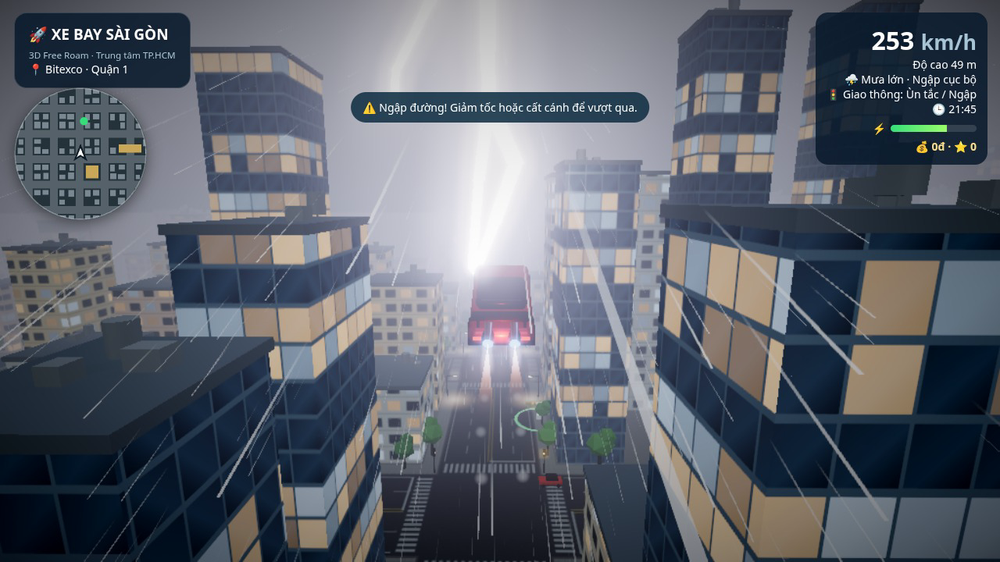

# 🚀 Xe Bay Sài Gòn

Game 3D thế giới mở chạy trên trình duyệt: lái — và **bay** — xe hơi giữa trung tâm TP.HCM cách điệu, qua phố đi bộ Nguyễn Huệ, Bitexco, Landmark 81, sông Sài Gòn và cầu Ba Son. Trời nắng rồi đổ mưa ngập đường, ngày chuyển sang đêm với đèn neon, sấm chớp; bạn nhận đơn giao hàng, chở khách, đua checkpoint qua các công trình biểu tượng và săn đèn lồng bí ẩn trên mái nhà.

Viết bằng **Three.js thuần** (không engine, không framework), mọi mô hình, texture và âm thanh đều **sinh bằng code** — không có file ảnh, mô hình 3D hay âm thanh nào được tải về. Bản build là trang tĩnh, triển khai trên **Cloudflare Workers Static Assets**.



---

## Mục lục
- [Tính năng](#tính-năng)
- [Điều khiển](#điều-khiển)
- [Thiết lập chất lượng](#thiết-lập-chất-lượng)
- [Cấu trúc dự án](#cấu-trúc-dự-án)
- [Chạy, build, kiểm tra và triển khai](#chạy-build-kiểm-tra-và-triển-khai)
- [Hạn chế đã biết](#hạn-chế-đã-biết)
- [Nhật ký thay đổi](#nhật-ký-thay-đổi)

---

## Tính năng

### Xe
| Xe | Tốc độ tối đa | Ghi chú |
|---|---|---|
| Tesla Roadster Rocket | ~158 km/h | Xe điện, nhanh nhất |
| Mercedes GLC 200 | ~115 km/h | Động cơ xăng — tiếng máy khác xe điện |
| VinFast VF8 Plus | ~126 km/h | Xe điện |
| Ninja xe Lead | ~90 km/h mặt đất, ~166 km/h khi bay | Xe ga, bay và **lộn vòng** (phím L). Đổi trang phục mỗi lần chọn lại |

Ba xe hơi tăng tốc (boost) nhân tốc độ tối đa ×1,6. Ninja Lead dùng thông số bay riêng (lực đẩy 9, lên 8 m/s, xoay 1,5 rad/s). Cả bốn đều bay được, có đèn pha, đèn hậu, bánh xe quay và lái theo góc cua.

### Đồ hoạ
- Vật liệu PBR (`MeshStandardMaterial`), tone mapping ACES, không gian màu sRGB, ánh sáng môi trường `RoomEnvironment` qua PMREM.
- Bầu trời `Sky` với **mặt trời di chuyển theo giờ** và **chu kỳ ngày/đêm** (1 giờ trong game ≈ 10 giây thực), sao ban đêm, sương mù hoà với đường chân trời.
- Bóng đổ mặt trời bám theo người chơi (có thể tắt ở chất lượng Thấp).
- Texture vẽ bằng canvas: mặt tiền nhà với **cửa sổ sáng đèn ban đêm**, mặt đường nhựa, vỉa hè, vạch kẻ, vạch sang đường, sân đỗ trực thăng.
- Sông Sài Gòn dùng `Water` có phản chiếu (Trung bình/Cao).
- `InstancedMesh` cho nhà, cây, đèn đường, đèn giao thông và xe AI — hàng trăm vật thể chỉ với vài lệnh vẽ.
- Công trình biểu tượng cách điệu: **Bitexco** với sân đỗ trực thăng, **Landmark 81** dạng khối bậc thang với dải LED, UBND Thành phố, phố đi bộ Nguyễn Huệ có đài phun nước, cầu Ba Son dây văng.
- Hậu kỳ `EffectComposer`: bloom, SMAA, vignette (Trung bình/Cao).
- Độ phân giải động (0,6–1,0) tự hạ khi FPS thấp và tăng lại khi dư sức.

### Hiệu ứng & âm thanh
- **Mưa hạt** tính trên GPU, nghiêng theo tốc độ xe; nước bắn tung toé khi chạy qua chỗ ngập hoặc đường ướt.
- **Đường ướt** bóng dần lên khi mưa và khô dần khi tạnh; vũng ngập lan rộng khi mưa lớn; sương mù dày hơn khi mưa.
- **Sấm chớp** khi mưa lớn: tia sét, trời loé sáng, tiếng sấm trễ theo khoảng cách, rung camera.
- 4 kiểu thời tiết (Nắng, Mưa rào, Mưa lớn · Ngập cục bộ, Nhiều mây) **chuyển mượt** trong ~5 giây, tự đổi mỗi 75 giây.
- Ban đêm: đèn pha `SpotLight`, đèn hậu đỏ, quầng sáng dưới đèn đường, đèn đường gần nhất chiếu sáng thật, **biển neon tiếng Việt** (PHỞ, CÀ PHÊ, KARAOKE, BÁNH MÌ, KHÁCH SẠN, BIA SÀI GÒN, NHÀ THUỐC, CƠM TẤM).
- Lửa phản lực và vệt khói/hơi nước khi bay hoặc boost, khói lốp khi drift, tia lửa khi va chạm, rung camera khi cất/hạ cánh và va chạm.
- **Âm thanh tổng hợp bằng WebAudio** (không có file âm thanh): tiếng máy đổi theo tốc độ (xăng và điện khác nhau), tiếng phản lực, gió, mưa, sấm, còi xe, xe AI bấm còi xung quanh, nước bắn, tiếng va chạm, chuông nhiệm vụ. Âm thanh bật sau lần bấm phím/chạm đầu tiên.

### Gameplay
- **Vật lý có quán tính**: xe trượt nhẹ khi vào cua, bám đường kém hơn khi đường ướt, **drift** khi giữ Shift (hoặc phanh) và đánh lái ở tốc độ cao. Khi bay xe **nghiêng theo hướng rẽ** và chúc/ngóc mũi theo độ cao.
- **Va chạm** với nhà, công trình và xe AI (hộp bao AABB / hình tròn). Có trọng lực: có thể **hạ cánh và chạy trên mái nhà**, chạy ra mép là rơi xuống.
- **Giao thông thông minh**: đèn giao thông ở các ngã tư với chu kỳ lệch nhau; xe máy và ô tô AI **dừng đèn đỏ**, giữ khoảng cách với xe phía trước, giảm tốc khi xe bạn chắn đường và khựng lại khi bị đâm.
- **Năng lượng**: bay và boost tiêu hao năng lượng; hết năng lượng thì xe hạ cánh khẩn cấp và không boost được. Sạc tại **6 trạm sạc VinFast** (vòng xanh, hiện trên bản đồ nhỏ) bằng cách dừng xe trong vòng; xe điện tự sạc nhẹ khi phanh.

### Nhiệm vụ
Lái vào **cột sáng** gần điểm xuất phát (hoặc bấm **N** / nút 🎯) để nhận nhiệm vụ:

| Nhiệm vụ | Mô tả | Thưởng |
|---|---|---|
| 📦 **Giao hàng** | Mang kiện hàng (bánh mì, trà sữa, hoa tươi…) tới một con đường ngẫu nhiên trong thời gian giới hạn | 30.000đ + theo quãng đường + thưởng thời gian còn lại |
| 🚕 **Chở khách** | Đón khách rồi đưa tới nơi; được cộng thêm giờ sau khi đón | 40.000đ + theo quãng đường + thưởng thời gian |
| 🏁 **Đua checkpoint** | Nguyễn Huệ → nóc UBND Thành phố → sân đỗ trực thăng Bitexco → đỉnh Landmark 81 → cầu Ba Son trong 170 giây (phải bay; HUD chỉ cần lên/xuống bao nhiêu mét) | 150.000đ + thưởng thời gian, lưu **kỷ lục** |
| 🏮 **Đèn lồng bí ẩn** | 12 đèn lồng giấu trên mái nhà, luôn mở | 50.000đ + 100 điểm mỗi đèn |

Điểm đến được đặt theo tên đường Sài Gòn (Pasteur, Hai Bà Trưng, Lê Lợi, Hàm Nghi…). Tiền, điểm, số đơn giao, số khách, kỷ lục đua và đèn lồng đã tìm được **lưu trong `localStorage`** của trình duyệt.

### Giao diện (HUD)
Bản đồ nhỏ xoay theo hướng xe (mục tiêu, trạm sạc, điểm nhận nhiệm vụ), bảng nhiệm vụ với **mũi tên chỉ hướng**, khoảng cách và **đồng hồ đếm ngược**, thanh năng lượng, tiền và điểm, tốc độ, độ cao, thời tiết, tình trạng giao thông, giờ trong game, **menu tạm dừng** (chất lượng đồ hoạ, tuỳ chọn, thành tích, hướng dẫn).

---

## Điều khiển

### Bàn phím
| Phím | Chức năng |
|---|---|
| **W** / **↑** | Tăng ga |
| **S** / **↓** | Phanh / lùi |
| **A** / **←**, **D** / **→** | Rẽ trái / phải |
| **Shift** (trái) | Boost (tốn năng lượng); Shift + rẽ ở tốc độ cao để drift |
| **Space** | Cất cánh / hạ cánh |
| **E** / **Q** | Bay lên / hạ xuống (khi đang bay) |
| **H** | Bấm còi |
| **N** | Nhận nhiệm vụ tiếp theo (xoay vòng giao hàng → chở khách → đua) |
| **Esc** / **P** | Tạm dừng / tiếp tục |
| **C** | Đổi camera: bám sau xe → buồng lái → nhìn từ trên cao |
| **R** | Đổi thời tiết |
| **T** | Tua nhanh 6 giờ |
| **L** | Lộn vòng (chỉ Ninja Lead, khi đang bay và cách mặt đất ít nhất 4 m). Hướng nghiêng theo lái |
| **M** | Bật / tắt tiếng |
| Kéo chuột | Xoay camera tạm thời, rồi trả về phía sau xe |

### Cảm ứng (điện thoại, máy tính bảng)
Máy có con trỏ thô (`pointer: coarse`) và màn hình cảm ứng mở sẵn cần điều khiển. Nút **Bàn phím / Cảm ứng** đổi chế độ và ghi vào `localStorage` (`xebay.controls`). `?controls=touch` hoặc `?controls=keyboard` ép một lần, không ghi đè lựa chọn đã lưu.

Cần bên trái: kéo ngang để lái, lên để ga, xuống để phanh. Có thể chạm nhiều ngón cùng lúc. Nút bên phải (tối thiểu 48 px, hơi trong suốt, né vùng an toàn của màn hình):

| Nút | Chức năng |
|---|---|
| ▲ / ▼ | Ga / phanh |
| ↑ / ↓ | Bay lên / hạ xuống |
| ⚡ | Boost |
| 🚀 | Cất cánh / hạ cánh |
| 🌀 | Lộn vòng |
| 📯 | Bấm còi |

Khi xoay dọc có dòng nhắc xoay ngang; game vẫn chơi được. Trang không cuộn hay phóng to khi đang chơi.

Bảng chọn xe, chất lượng, **🚀 Bay / Hạ cánh**, **🌀 Lộn vòng**, **🌦 Đổi thời tiết**, **🎯 Nhiệm vụ** và **⏸ Tạm dừng** vẫn ở trên màn hình. Trên màn hình hẹp, các nút Camera, Ngày/Đêm, Âm thanh và Reset nằm trong menu tạm dừng (kèm **Hủy nhiệm vụ** và **Về vạch xuất phát**). Nút **?** mở lại hướng dẫn ngắn của chế độ đang dùng.

---

## Thiết lập chất lượng

Chọn trong bảng điều khiển hoặc menu tạm dừng; lựa chọn được lưu lại. Mặc định là **Thấp** trên thiết bị cảm ứng / màn hình hẹp (< 760 px) và **Trung bình** trên máy tính.

| | Thấp | Trung bình | Cao |
|---|---|---|---|
| Đổ bóng | Tắt | 1024 px | 2048 px |
| Hậu kỳ (bloom, SMAA, vignette) | Tắt | Bật | Bật |
| Vật liệu / bầu trời | Lambert + bầu trời gradient | PBR + `Sky` | PBR + `Sky` |
| Sông | Mặt nước đơn giản | `Water` phản chiếu 256 px | `Water` phản chiếu 512 px |
| Mật độ pixel tối đa | 1 | 1,25 | 1,75 |
| Lọc texture (anisotropy) | 1 | 4 | 8 |
| Xe AI / cây | 50% / 45% | 80% / 75% | 100% / 100% |
| Hạt mưa | 1.800 | 4.500 | 9.000 |
| Đèn đường chiếu sáng thật | 0 | 3 | 6 |
| Hạt khói/nước | 40% | 75% | 100% |

Mọi mức đều dùng độ phân giải động. Tham số URL để thử nghiệm: `?q=low|medium|high`, `?hour=0–24` (giờ bắt đầu), `?weather=0–3` (thời tiết bắt đầu). Ví dụ: `/?q=high&hour=21&weather=2` — đêm mưa lớn ở chất lượng Cao.

---

## Cấu trúc dự án

```
index.html          Giao diện HUD + CSS; import map chỉ dùng khi phát triển
scripts/build.mjs   Kiểm tra tính năng, bundle src/main.js bằng esbuild → public/
wrangler.jsonc      Cấu hình Cloudflare Workers Static Assets (thư mục ./public)
docs/               Ảnh minh hoạ cho README
src/                Mã nguồn (ES modules)
```

| File trong `src/` | Vai trò |
|---|---|
| `main.js` | Điểm vào: tạo scene/renderer, khởi tạo các module, vòng lặp game, camera, phím tắt, tạm dừng, độ phân giải động |
| `settings.js` | Ba mức chất lượng Thấp/Trung bình/Cao, đọc/lưu lựa chọn, phát hiện thiết bị di động |
| `world.js` | Lưới đường, nhà instanced với shader mặt tiền, mái và đồ trên mái, cây, đèn đường, sông, tên địa điểm |
| `landmarks.js` | Bitexco, Landmark 81, UBND Thành phố, phố đi bộ Nguyễn Huệ, cầu Ba Son và vùng chiếm chỗ của chúng |
| `textures.js` | Texture sinh bằng canvas: mặt đường, mặt tiền (cửa sổ sáng đêm), sân trực thăng, tường thuộc địa, pháp tuyến mặt nước |
| `sky.js` | Bầu trời `Sky`/gradient, mặt trời–mặt trăng, chu kỳ ngày đêm, sao, bóng đổ, ánh sáng môi trường, màu sương mù |
| `materials.js` | Đổi qua lại vật liệu PBR ↔ Lambert theo mức chất lượng và đồng bộ thuộc tính |
| `postfx.js` | Chuỗi hậu kỳ: bloom, SMAA, vignette |
| `vehicles.js` | Mô hình 3 xe của người chơi, vật liệu đèn, bánh xe, vị trí ống phản lực |
| `traffic.js` | Xe máy/ô tô AI instanced, đèn giao thông, dừng đèn đỏ, giữ khoảng cách, chọn xe bấm còi |
| `weather.js` | Bốn kiểu thời tiết, chuyển mượt, độ ướt mặt đường, vũng ngập, lịch sét |
| `effects.js` | Mưa GPU, hệ hạt, lửa phản lực, tia sét, rung camera |
| `carfx.js` | Hiệu ứng gắn với xe: khói/hơi phản lực, nước bắn, khói lốp drift, rung khi cất/hạ cánh |
| `lights.js` | Ánh sáng đêm: đèn pha, đèn hậu, quầng sáng đèn đường, biển neon, đèn đường động |
| `audio.js` | Âm thanh WebAudio tổng hợp: máy, phản lực, gió, mưa, sấm, còi, hiệu ứng ngắn |
| `gameplay.js` | Vật lý xe (quán tính, drift, nghiêng khi bay, trọng lực), va chạm, năng lượng |
| `missions.js` | Nhiệm vụ giao hàng/chở khách/đua, đèn lồng, trạm sạc VinFast, lưu thành tích |
| `minimap.js` | Bản đồ nhỏ xoay theo xe và hướng tới mục tiêu |
| `hud.js` | Cập nhật HUD, bảng nhiệm vụ, thanh năng lượng, menu tạm dừng, gắn sự kiện nút |
| `input.js` | Phát hiện cảm ứng hoặc bàn phím/chuột, cần ảo, nút chạm, kéo chuột xoay camera |
| `scooter.js` | Lưới xe ga Ninja Lead và người lái (hai bộ đồ) |
| `stunt.js` | Điều kiện và đường cong lộn vòng |

---

## Chạy, build, kiểm tra và triển khai

Yêu cầu: **Node.js 18+** (đã thử với Node 22).

```bash
npm install
```

### Chạy khi phát triển (không cần build)
`index.html` có import map trỏ `three` vào `node_modules`, nên chỉ cần phục vụ thư mục gốc bằng một web server tĩnh bất kỳ:

```bash
python3 -m http.server 8080
# mở http://localhost:8080
```

Sửa file trong `src/` rồi tải lại trang là thấy thay đổi.

### Build
```bash
npm run build
```
`scripts/build.mjs` kiểm tra các tính năng bắt buộc còn trong mã nguồn, bundle `src/main.js` (kèm Three.js) bằng esbuild thành `public/game.js` đã nén, và ghi `public/index.html` (bỏ import map, trỏ sang `/game.js`). Thư mục `public/` là bản hoàn chỉnh tự chứa — có thể xem thử bằng `python3 -m http.server -d public 8080` hoặc `npm run dev` (Wrangler chạy cục bộ).

### Kiểm tra
```bash
npm run check
```
Chạy unit test (`node --test`) cho cách chọn chế độ điều khiển và lộn vòng, build, rồi `wrangler deploy --dry-run` để xác nhận cấu hình Cloudflare hợp lệ. Lệnh này phải thành công trước mỗi lần merge.

### Triển khai lên Cloudflare
Game chạy dưới dạng Worker chỉ có static assets — không cần server, D1, R2 hay KV.

```bash
npx wrangler login   # lần đầu
npm run deploy       # build + wrangler deploy
```

Wrangler sẽ in ra địa chỉ `*.workers.dev`. Thư mục được phục vụ là `public/` (khai báo trong `wrangler.jsonc`); `index.html` ở thư mục gốc chỉ là mã nguồn phát triển.

---

## Hạn chế đã biết
- Thành phố là **mô phỏng cách điệu sinh bằng thủ tục**, không phải dữ liệu bản đồ OpenStreetMap chính xác; công trình biểu tượng được đơn giản hoá và đặt vào giữa các ô phố. Xe không dùng mô hình 3D có bản quyền của hãng.
- Xe AI chỉ chạy thẳng theo trục đường của mình, **không rẽ ở ngã tư**; phố đi bộ Nguyễn Huệ và mặt sông không có xe AI chạy dọc.
- Chỉ vẽ 48 đèn giao thông gần người chơi nhất (để tiết kiệm hiệu năng); đèn không áp dụng luật cho người chơi.
- Cây, cột đèn, đài phun nước không có va chạm; tháp Bitexco (hình tròn) va chạm như một khối hộp.
- Mức **Thấp** dùng vật liệu Lambert và bầu trời gradient thay cho PBR/`Sky` để giữ khung hình trên điện thoại.
- Mục tiêu 60 FPS ở mức Thấp trên điện thoại **chưa được đo trên thiết bị thật**; các phép đo trong quá trình phát triển được thực hiện bằng kết xuất phần mềm (không có GPU), chỉ dùng để so sánh tương đối giữa các phiên bản.
- Âm thanh chỉ bắt đầu sau lần tương tác đầu tiên (quy định autoplay của trình duyệt).
- Thành tích chỉ lưu cục bộ trong trình duyệt, không có bảng xếp hạng trực tuyến.

---

## Nhật ký thay đổi

Bản nâng cấp được thực hiện qua 4 PR nối tiếp nhau, đã merge vào `main`:

| PR | Nội dung |
|---|---|
| [#1 — Tái cấu trúc thành module](https://github.com/sycu8/Dao-choi-saigon/pull/1) | Tách game một file thành các ES module trong `src/` (main, world, vehicles, traffic, weather, effects, gameplay, hud, input); `scripts/build.mjs` bundle từ `src/main.js` bằng esbuild và giữ các bước kiểm tra tính năng; import map để chạy trực tiếp khi phát triển. |
| [#2 — Nâng cấp đồ hoạ](https://github.com/sycu8/Dao-choi-saigon/pull/2) | Vật liệu PBR, ACES, sRGB, RoomEnvironment/PMREM; bầu trời `Sky` với mặt trời động và chu kỳ ngày/đêm; bóng đổ bám người chơi; texture canvas (cửa sổ sáng đêm, mặt đường, vỉa hè, vạch kẻ); sông `Water`; `InstancedMesh` cho nhà, cây, đèn, xe AI; công trình biểu tượng chi tiết (sân trực thăng Bitexco, Landmark 81 bậc thang); bloom + SMAA + vignette; ba mức chất lượng và độ phân giải động. |
| [#3 — Hiệu ứng và âm thanh](https://github.com/sycu8/Dao-choi-saigon/pull/3) | Mưa hạt GPU nghiêng theo tốc độ, nước bắn khi ngập; đường ướt, sương mù dày khi mưa, sấm chớp; đèn pha/đèn hậu, đèn đường và biển neon ban đêm; lửa phản lực, vệt khói, rung camera; chuyển thời tiết mượt; âm thanh WebAudio tổng hợp (máy, mưa, sấm, còi). |
| [#4 — Gameplay](https://github.com/sycu8/Dao-choi-saigon/pull/4) | Vật lý quán tính, drift, nghiêng khi bay, chạy trên mái nhà; va chạm AABB với nhà và xe AI; đèn giao thông, AI dừng đèn đỏ và giữ khoảng cách; nhiệm vụ giao hàng, chở khách, đua checkpoint, đèn lồng trên mái; tiền, điểm, kỷ lục trong `localStorage`; năng lượng và trạm sạc VinFast; bản đồ nhỏ, mũi tên mục tiêu, đồng hồ, menu tạm dừng với cài đặt chất lượng. |
